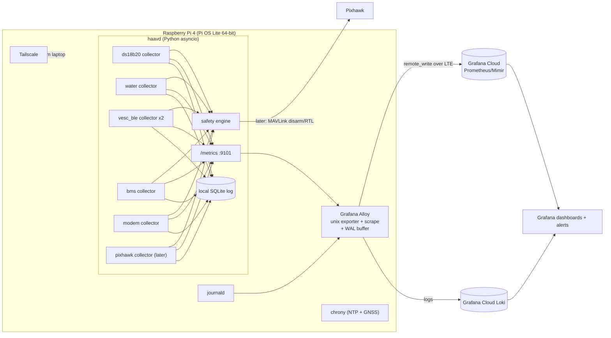

# haav-telemetry

Software that runs on Haav's Raspberry Pi 4. It reads the boat's sensors, keeps a local log, and sends
telemetry over LTE to Grafana Cloud. Pixhawk (MAVLink) telemetry comes later; the design leaves room for it.

---

## 1. What the design docs say (summary of `../haav` + the Nov 2026 design-review slides)

**The boat.** Haav is a 4 ft autonomous RIB built for the PEP27 Autonomy race: 2 miles, a 45-minute
on-water limit, and a 55.5 V pack limit. It has a 3D-printed deep-V hull, glassed and fitted with
inflatable tubes. Two Flipsky 65150 pods, each with a VESC built in, run on 12S and steer by
differential thrust. None of it has been in the water yet.

**Electrical (slide 36, "Low Voltage").**
- A 12 V supply (source TBD) feeds the servo, the cooling pump, and a 12→5 V converter.
- The 5 V rail powers the **Pi, Pixhawk, sensors, LTE, GPS and RF receiver**.
- **Pixhawk** is the autopilot. It takes GPS, the RF receiver (manual override) and commands from the Pi, and drives
  the **ESCs ×2 and the servo over PWM**.
- **The Pi sits beside the Pixhawk as a companion computer.** It does logging, sensing and the LTE link. It never drives the motors itself.
  This matches the repo's long-standing rule: *keep a real autopilot for failsafe and return-to-home, and never control the motors from Pi GPIO*
  (`archive/thinking/hardware/02-brain-and-autopilot.md`).

**What the Pi connects to (slide 38).** LTE Cat-1, temperature sensors, water sensors, the Pixhawk,
the ESCs (over Bluetooth) and the BMS. The deck chose a Pi 4 over a Pi 5 because it draws 1–6 W less, throttles less,
gives 1.2 A of USB power by default, and has plenty of compute.

| Input | Hardware | Purpose | Interface on the Pi |
|---|---|---|---|
| LTE | Cat-1/GNSS HAT on the GPIO header, 4G data SIM (1NCE IoT plan under evaluation) | Remote telemetry and control. SSH over Tailscale/OpenVPN. Grafana for viewing | USB (through the HAT's pogo pins) + ModemManager |
| Temperature | DS18B20 waterproof probes, about 3: bow electronics, between the motors, battery bay | Watch hull temperature, check the water cooling, **shut down if too hot** | 1-Wire on one GPIO |
| Water / leak | DFRobot capacitive non-contact sensors, about 3: centre between the motors, two aft corners, 1–1.5" off the bottom | Early warning of leaks near electronics or the battery | Digital GPIO (one per sensor) |
| ESCs ×2 | VESCs built into the Flipsky pods | RPM, current, voltage, FET/motor temperature, faults | Bluetooth LE (VESC protocol) |
| BMS | **Model TBD** | Pack voltage and current, SoC, cell voltages, protection flags | **TBD** (UART, RS485 or BLE) |
| Pixhawk | ArduPilot | GPS, attitude, battery, mode. The Pi→Pixhawk command path | MAVLink over UART/USB (**later**) |
| Pi itself | — | CPU, memory, SoC temperature, throttling, disk, network. **Used as the first end-to-end test signal** | node metrics |

**Repo context.** The `archive/thinking/` docs describe the old catamaran plan: BlueOS, Cockpit, ELRS backup and a
Go "dream-company" stack. Its reasoning about dialing out from behind cellular NAT, GPS/LTE interference, and the
"buy the autopilot, build the app layer" split still holds. Its part list does not.
The white-paper **Risk** section (8 of 20 points) says half its points come from *real-world testing documentation*.
The telemetry log is that documentation, so local logging is a first-class requirement and not an afterthought.

---

## 2. Constraints that shape the software

1. **LTE will drop.** Expect coverage dead zones, a cold modem, or a lost antenna. Nothing safety-related can depend on
   the cloud, and telemetry has to buffer and catch up afterwards.
2. **The overheat shutdown must be decided on the Pi**, never in Grafana alerting. Grafana alerts are for
   people. The Pi does the shutdown itself, and later sends it to the Pixhawk over MAVLink (e.g. disarm/RTL).
3. **The data plan is small.** IoT SIMs are metered, and a 1NCE-style lifetime plan is about 500 MB in total. Prometheus `node_exporter`
   produces about 1,000 series by default. Allow-list the metrics you send and choose scrape intervals on purpose.
4. **The Pi 4 has no RTC.** After a cold boot on the water the clock is wrong until NTP over LTE or a GNSS fix
   sets it. Bad timestamps poison both the cloud data and the local log.
5. **Power can be pulled at any time** (a battery swap or a kill switch). SD card corruption is the classic Pi failure.
6. **The LTE HAT sits on the GPIO header.** Sensors need a stacking or pass-through header and pins that don't
   clash with the HAT's UART and power-key pins.
7. **Grafana Cloud free-tier retention is short** (about 14 days for metrics). The local log on the Pi is the permanent record.

---

## 3. Recommended architecture



Two processes do the real work. Everything else is stock OS plumbing.

### 3.1 `haavd`: one Python daemon with pluggable collectors (the code we write)

- **Python 3 + asyncio.** Every library we need already exists for Python: `bleak` for BLE, `pyvesc` for VESC packets, `gpiod` for GPIO,
  `prometheus_client`, `pyserial`, and later `pymavlink`. A single process keeps memory low and lets the safety engine see all
  the readings at once.
- **Collector interface.** Each source is a class with `async def run(self, emit)`. It polls at its own rate and
  emits `Reading(name, value, labels, ts)`. Adding the Pixhawk later means adding one file. Start with:
  - `ds18b20`: read `/sys/bus/w1/devices/28-*/temperature` every 2 s. A config file maps ROM ID → location.
  - `water`: edge-triggered GPIO plus a periodic re-read, debounced.
  - `vesc_ble`: one BLE connection per pod, sending `COMM_GET_VALUES` at 2–5 Hz. Reconnects with backoff.
  - `bms`: a stub until the model is chosen. Most smart BMSs (JBD/Daly/ANT) speak a documented UART/BLE protocol.
  - `modem`: polls `mmcli` / ModemManager D-Bus for RSSI/RSRP/RSRQ/SINR, access technology and bytes used. **This is how you
    see dead zones and data-plan burn.**
  - `fake`: synthetic data so the whole pipeline runs on a laptop with no hardware.
- **Three sinks fed by the same readings:**
  1. **Prometheus `/metrics` on `localhost:9101`**, scraped by Alloy.
  2. **Local log**: SQLite in WAL mode at full rate, one row per reading, rotated per session (one file per boot or arming).
     This is the ground truth for post-run analysis and for the white paper.
  3. **Safety engine**: runs threshold rules from config (e.g. any temperature > X °C for 5 s, or any water sensor = 1).
     For now it raises a `haav_alarm{rule=...}` metric and logs to journald. Later it sends a MAVLink command to the Pixhawk.
     Hysteresis and debounce are required so a single bad read can't trigger a shutdown.
- **Collector health is a metric too**: `haav_collector_up{collector}` and
  `haav_collector_last_success_timestamp_seconds`. A dead DS18B20 must never look the same as 0 °C.
- **systemd service** with `Restart=always` and `WatchdogSec=` (the daemon pings sd_notify). Turn on the Pi hardware watchdog as well.

### 3.2 Grafana Alloy: the only thing that talks to Grafana Cloud

- Grafana's official agent. It ships arm64 `.deb` packages and runs as a systemd service.
- `prometheus.exporter.unix` collects the Pi's own metrics, so there's no separate node_exporter. **Filter it to an allow-list**:
  CPU, load, memory, filesystem, network bytes, `node_hwmon_temp_celsius`, and the boot time.
- `prometheus.scrape` scrapes `haavd` every 5 s. Use 15–30 s for system metrics.
- `prometheus.remote_write` sends to Grafana Cloud with a **WAL**. When LTE drops, samples queue on disk and replay
  when the link returns. Long outages beyond the cloud's out-of-order/too-old window are lost from the cloud,
  **but not from the local SQLite log**, which is why that log exists.
- `loki.source.journal` → Grafana Cloud Loki for `haavd`, `alloy`, ModemManager and Tailscale logs, filtered to
  warning and above plus `haavd` info.
- Add `external_labels = { boat = "haav", host = "haav-pi" }`.
- The Grafana Cloud token lives in `/etc/default/alloy`, **never in git**.

Pi throttling flags (`vcgencmd get_throttled`: under-voltage!) aren't in the unix exporter. A 15 s systemd timer
(`deploy/pi-health/pi-health.sh`) writes them to Alloy's textfile collector as `haav_pi_*`, so they work before
`haavd` exists. Under-voltage on the 5 V rail is something we specifically want to catch on this boat.

**Implemented:** see [Pi metrics setup](#pi-metrics-setup-build-step-2) below.

### 3.3 OS plumbing (configured, not written)

| Concern | Choice |
|---|---|
| OS | Raspberry Pi OS Lite 64-bit (Bookworm or newer) |
| LTE | ModemManager + NetworkManager. Set the APN in an NM connection. Bring-up with no manual AT commands |
| Remote access | **Tailscale** for SSH. It dials out, so cellular NAT is no problem. No inbound ports |
| Time | `chrony`, using NTP when online and GNSS (HAT or Pixhawk via `gpsd`) as a fallback. Log `clock_synced` as a metric |
| SD card | High-endurance card. `journald` with `Storage=volatile` or capped. Keep heavy writes to the SQLite log only. Consider read-only root (overlayfs) once things are stable |
| Deploy | `deploy/install.sh` installs the venv, systemd units and Alloy config. Run it again to update (`git pull && ./deploy/install.sh` over Tailscale) |

### 3.4 Metric naming (keep it consistent from day one)

```
haav_temperature_celsius{location="bow|motor_bay|battery", sensor_id="28-..."}
haav_water_detected{location="center|aft_port|aft_stbd"}            # 0/1
haav_esc_rpm / _input_voltage_volts / _motor_current_amps / _input_current_amps
haav_esc_fet_temperature_celsius / _motor_temperature_celsius / _duty_ratio / _fault_code   {side="port|stbd"}
haav_bms_pack_voltage_volts / _current_amps / _soc_ratio / _cell_voltage_volts{cell} / _protection_flags
haav_lte_rssi_dbm / _rsrp_dbm / _rsrq_db / _sinr_db / _registered
haav_pi_throttled_flags / haav_clock_synced
haav_alarm{rule}  haav_collector_up{collector}
# later: haav_mav_* (gps lat/lon/sats, attitude, mode, armed, battery)
```

Grafana's Geomap panel can plot `haav_mav_gps_lat`/`_lon` directly from Prometheus once the Pixhawk feeds it.

### 3.5 Grafana Cloud side

- Commit the dashboards as JSON in `dashboards/`: **Boat overview** (temperatures, water, ESCs, BMS, link quality,
  alarms), **Pi health**, and **Link/data usage**.
- Alerts (to Discord/Slack/email): any `haav_alarm` firing, `haav_water_detected == 1`, a temperature over threshold,
  `haav_collector_up == 0`, and `absent(up{job="haavd"})` for 2 m ("boat went dark").
  These are notifications only, not controls.

---

## 4. Data budget (estimate it, then measure it)

Remote-write cost depends on how many series you send, not how many sensors you have. Rough numbers: **about 100 series at 5–15 s ≈
10–20 MB per powered-on hour.** That's fine on a normal data plan but significant against a 500 MB lifetime cap. Levers:
the allow-list, a longer interval for slow signals (Pi health 30 s), and an optional "dock mode" (Wi-Fi present → full rate).
The `modem` collector's byte counters show the real burn rate. Check it after the first hour.

---

## 5. Pixhawk later (the hook to leave in now)

- Connect a Pixhawk TELEM port to the Pi over **USB or a spare Pi 4 UART** (`dtoverlay=uart3/4/5`). The LTE HAT may
  already be using the primary UART.
- Run **`mavlink-router`** on the Pi to split the stream: one endpoint for `haavd`'s `pixhawk` collector (pymavlink:
  `HEARTBEAT`, `SYS_STATUS`, `GPS_RAW_INT`, `GLOBAL_POSITION_INT`, `ATTITUDE`, `BATTERY_STATUS`, `VFR_HUD`), and one UDP
  endpoint over Tailscale for a laptop ground station (QGroundControl/Mission Planner).
- The safety engine gets an actuator: `MAV_CMD_COMPONENT_ARM_DISARM` or a mode change to RTL/HOLD. This needs a deliberate design review
  (who wins, the Pi or the RF override?) before it's enabled.
- ArduPilot can also stream the Pi's sensor values *into* its own dataflash log via `NAMED_VALUE_FLOAT`. Optional.

---

## 6. Build order

1. **Pi bring-up:** OS, Tailscale, LTE HAT online through ModemManager, chrony.
2. **Pi metrics → Grafana Cloud through Alloy.** This proves the whole pipeline end to end with zero sensors. Pull the antenna for
   10 minutes and check that the WAL backfills.
3. **`haavd` skeleton + `fake` collector + local SQLite log + `/metrics`.** Develop on a laptop.
4. **DS18B20 → safety engine** (overheat rule with hysteresis) **→ water sensors.**
5. **Modem metrics, then VESC over BLE, then BMS** (once the model is known).
6. **Dashboards and alerts committed to the repo.**
7. **Pixhawk via mavlink-router** (see §5).

Suggested layout:

```
haavd/            # python package: collectors/, safety.py, sinks/ (prom, sqlite), config.py, __main__.py
config/haav.toml  # sensor ROM IDs → locations, thresholds, poll rates
deploy/           # install.sh, systemd/*.service, alloy/config.alloy, chrony/, NetworkManager APN
dashboards/       # Grafana JSON
tools/            # session export (SQLite → CSV/Parquet), bench scripts
```

---

## Pi metrics setup (build step 2)

This sends the Pi's own health to Grafana Cloud with no sensors attached. Use it to prove the LTE → cloud path.

```sh
git clone https://github.com/haav-uwmadison/haav-telemetry && cd haav-telemetry
sudo ./deploy/install.sh          # first run creates /etc/haav/grafana-cloud.env and stops
sudo nano /etc/haav/grafana-cloud.env   # URL + user from Grafana Cloud → Prometheus → "Send metrics";
                                        # token = access policy with metrics:write
sudo ./deploy/install.sh          # installs Alloy + the pi-health timer and starts them
```

| File | What it does |
|---|---|
| `deploy/alloy/config.alloy` | Built-in node exporter with an allow-list of about 60 series, scraped every 15 s, then `remote_write` to Grafana Cloud with an 8 h disk buffer |
| `deploy/pi-health/pi-health.sh` + `deploy/systemd/haav-pi-health.*` | Every 15 s, writes `vcgencmd` under-voltage/throttle/clock/core-voltage as `haav_pi_*` metrics |
| `deploy/install.sh` | Installs Alloy from Grafana's apt repo and loads the credentials through a systemd drop-in. Safe to re-run |

Metrics sent: CPU (user/system/idle/iowait per core), load, memory, SD free space and read-only flag, network bytes
per interface (`wwan0` = LTE, which tracks data usage), SoC temperature (`node_thermal_zone_temp`), boot time, and
`haav_pi_throttle_state{condition,when}`. Every series carries `boat="haav"` and `host=<hostname>`.

**Check it:** the Alloy UI at `http://<pi>:12345` (over Tailscale) shows each component's health. In Grafana Cloud → Explore,
run `node_thermal_zone_temp{boat="haav"}`. To test buffering, unplug the LTE antenna for 10 minutes, plug it back in,
and check that the graph has no gap.

---

## 7. Open hardware questions that block software

- **BMS model and interface.** Without it the `bms` collector can't be written.
- **Exact LTE HAT model and pinout.** This decides the 1-Wire/water GPIO pins, whether the HAT's GNSS is available to the Pi,
  and which UART is free for the Pixhawk.
- **Water-sensor output voltage.** The DFRobot capacitive sensor runs on 5 V+. **Check that its output is 3.3 V-safe** before
  wiring it to a Pi GPIO, or add a divider/level shifter. DS18B20 data must be pulled up to **3.3 V** (4.7 kΩ), not 5 V.
- **VESC over BLE vs. wired UART/CAN.** BLE works, but each module allows one connection (a phone running VESC Tool blocks
  the Pi), and it's a radio inside a sealed hull next to the LTE antenna. Wired is more robust if the pods expose it.
- **SIM data cap.** Decide the plan before tuning the intervals in §4.
