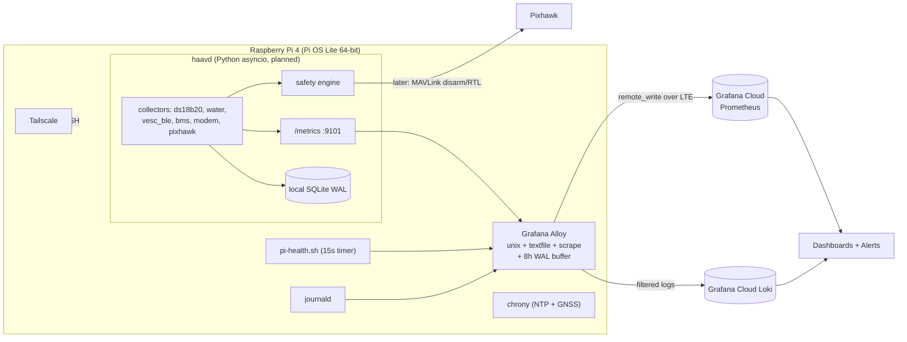

# haav-telemetry

Telemetry software for Haav's Raspberry Pi 4: reads boat sensors, logs locally, and pushes Pi and Pixhawk (MAVLink) metrics over LTE to Grafana Cloud.

**Status:** Step 2 (Pi health metrics + filtered system logs → Grafana Cloud via Alloy) and Pixhawk MAVLink telemetry (`haav-mavlink`) are built and ready to test on a Pi; Grafana dashboards are in `dashboards/`. Sensor daemon (`haavd`) and alerts are planned below.

---

## Quick start (Pi metrics & logs → Grafana Cloud)

Proves the LTE → Grafana Cloud pipeline with zero sensors attached.

```sh
git clone https://github.com/haav-uwmadison/haav-telemetry && cd haav-telemetry
sudo ./deploy/install.sh                 # creates /etc/haav/grafana-cloud.env and exits
sudo nano /etc/haav/grafana-cloud.env    # fill Prometheus + Loki URLs/users from Grafana Cloud Details
                                         # and an access-policy token with metrics:write + logs:write
sudo ./deploy/install.sh                 # installs/updates Alloy + pi-health timer and starts both
```

| File | Purpose |
|---|---|
| `deploy/alloy/config.alloy` | Built-in `unix` exporter (~60 allow-listed series @ 15 s → Prometheus `remote_write` with 8 h WAL) + filtered `systemd-journald` → Loki |
| `deploy/pi-health/pi-health.sh` + `deploy/systemd/haav-pi-health.*` | 15 s systemd timer writing `vcgencmd` under-voltage/throttle flags, ARM clock, and core voltage to `/var/lib/haav/textfile` |
| `deploy/install.sh` | Idempotent installer: sets up Grafana's apt repo, Alloy (+ `systemd-journal` group), systemd drop-in (`/etc/systemd/system/alloy.service.d/haav.conf`), and `haav-pi-health.timer` |
| `deploy/grafana-cloud.env.example` | Template copied to `/etc/haav/grafana-cloud.env` (`chmod 600`, gitignored) |
| `deploy/mavlink/haav-mavlink.py` + `deploy/systemd/haav-mavlink.service` | Reads Pixhawk MAVLink (SiK radio, USB, or UART), serves `haav_mav_*` on `127.0.0.1:9102` (Alloy scrapes every 5 s), and logs events to journald → Loki. Python venv at `/opt/haav/mavlink-venv` |
| `deploy/mavlink.env.example` | Copied once to `/etc/haav/mavlink.env`: serial device/baud and servo output names |

**Dashboards** (`dashboards/`, not deployed to the Pi): JSON is generated, so edit the `build_*.py` script and regenerate (`python3 dashboards/build_pi.py dashboards/pi.json`), then import into Grafana Cloud (Dashboards → New → Import, overwrite).

| File | Dashboard |
|---|---|
| `underway.json` ← `build_underway.py` | **Haav underway**: what to watch while the boat runs (Pixhawk + Pi status tiles, GPS track, speed/battery/nav/temps, LTE, events; bench panels collapsed) |
| `pi.json` ← `build_pi.py` | **Haav Pi**: drill-down (decoded throttle flags, temp vs clock, per-core CPU, memory, SD space/I/O/time-until-full, per-interface network + link state + errors, LTE burn vs 500 MB SIM, sample lag, logs by unit/level) |
| `panels.py` | Shared panel builders |

**Editing dashboards with Claude Code ([Grafana MCP](https://github.com/grafana/mcp-grafana)):** lets Claude query Prometheus/Loki, check panel queries against real data, render panels, and push dashboards.

1. Grafana Cloud → **Administration → Users and access → Service accounts → Add service account**, role **Editor** → **Add service account token** (`glsa_…`).
2. With Docker running, register the server once per machine (user scope keeps the token in `~/.claude.json`, out of the repo; don't use `-s project`, which writes `.mcp.json`):
   ```sh
   claude mcp add grafana -s user \
     -e GRAFANA_URL=https://<stack>.grafana.net \
     -e GRAFANA_SERVICE_ACCOUNT_TOKEN=glsa_xxx \
     -- docker run --rm -i -e GRAFANA_URL -e GRAFANA_SERVICE_ACCOUNT_TOKEN mcp/grafana -t stdio
   ```
3. `claude mcp list` should show `grafana … ✔ Connected`; start a new Claude Code session so the tools load. Never paste the token into chat.

**Metrics sent:** CPU (user/system/idle/iowait per core), load, memory, SD free space & read-only flag, SD I/O (`mmcblk0` bytes/ops/busy), network bytes, errors/drops & link state (`eth0`, `wlan0`, `wwan0` = LTE burn rate, `usb0`, `tailscale0`), SoC temperature (`node_thermal_zone_temp` / `node_hwmon_temp_celsius`), boot time, and `haav_pi_*` firmware health.

**Pixhawk metrics (`haav_mav_*`, ~50 series @ 5 s):** link (`connected`, `radio_rssi/remrssi/noise/rxerrors`, `rc_rssi`), state (`armed`, `mode{mode}`, `system_status`), navigation (`gps_lat/lon`, `groundspeed_mps`, `heading_deg`, `mission_seq`, `wp_dist_m`, `xtrack_error_m`), health (`gps_fix_type/sats/hdop`, `ekf_flags`, `ekf_variance{kind}`, `sensor_healthy{sensor}`, `vcc_volts`, `roll_deg/pitch_deg`, `board_temp_celsius`, `clock_offset_seconds`), and power/control (`battery_volts/amps/remaining_ratio/consumed_mah`, `servo_pwm{output}`, `throttle_percent`). Each metric disappears 10 s after its MAVLink message stops arriving, so a lost link shows as a gap instead of a frozen value. The service is read-only: it sends only `SET_MESSAGE_INTERVAL` and never sends HEARTBEATs, so stopping it can't trigger a GCS failsafe.

**Logs sent:** `WARNING`+ from `kernel`, `ModemManager`, `tailscaled`, `alloy`, and `haav-pi-health`; `INFO`+ from `haav-mavlink` (Pixhawk `STATUSTEXT` at its own severity, mode changes, arm/disarm, waypoints reached, link up/down) and `haavd` once built. All metrics and logs carry `host=<hostname>` to separate the boat's Pi from a bench Pi or laptop.

**Verify:** open Alloy's UI at `http://<pi>:12345` (over Tailscale), query `node_thermal_zone_temp` (Prometheus) and `{job="systemd-journal"}` (Loki) in Grafana Cloud → Explore, then unplug the LTE antenna for 10 min and confirm metrics backfill with no gap. For the Pixhawk: `journalctl -u haav-mavlink -f` should show `autopilot link up`, and `curl -s localhost:9102/metrics` should list `haav_mav_*`.

---

## 1. Boat & hardware summary (`../haav` + Nov 2026 review slides)

Haav is a 4 ft autonomous RIB for the PEP27 Autonomy race (2 mi, 45 min limit, 55.5 V pack limit), powered by two 12S Flipsky 65150 pods with built-in VESCs (differential thrust). A 12 V supply feeds the servo, cooling pump, and a 12→5 V converter powering the Pi 4, Pixhawk, sensors, LTE, GPS, and RF receiver.

**Companion split:** the Pixhawk owns motors (ESCs ×2 + servo via PWM), RF manual override, and failsafe/RTH. The Pi 4 (chosen over Pi 5 for 1–6 W lower draw and 1.2 A USB power) handles sensing, local logging, and LTE—it never drives motors directly. Local logs also serve as real-world test evidence for the PEP27 Risk white paper (8/20 points).

| Input | Hardware | Purpose | Pi interface |
|---|---|---|---|
| LTE | Cat-1/GNSS HAT + 4G IoT SIM (1NCE under eval) | Telemetry, Tailscale SSH | USB (pogo pins) + ModemManager |
| Temperature | ~3× DS18B20 waterproof (bow, motors, battery) | Hull/cooling health, **overheat shutdown** | 1-Wire (1 GPIO) |
| Water / leak | ~3× DFRobot capacitive (center, aft port/stbd, 1–1.5" up) | Early leak warning | Digital GPIO (1/sensor) |
| ESCs ×2 | Flipsky pod VESCs | RPM, V/I, FET/motor temp, faults | BLE (VESC protocol) |
| BMS | **TBD** | Pack V/I, SoC, cell V, protection flags | **TBD** (UART/RS485/BLE) |
| Pixhawk | ArduPilot | GPS, attitude, mode, Pi→Pixhawk commands | MAVLink UART/USB (**later**) |
| Pi itself | — | CPU, mem, temp, throttle/under-voltage, disk, net | Alloy `unix` + `vcgencmd` (**built**) |

---

## 2. Constraints

1. **LTE will drop.** Nothing safety-critical can depend on the cloud; telemetry must buffer locally and catch up.
2. **Overheat shutdown runs on the Pi**, never in Grafana alerts (later triggers Pixhawk MAVLink disarm/RTL).
3. **Small metered SIM** (~500 MB lifetime cap on 1NCE). Allow-list metrics and tune intervals: ~100 series @ 5–15 s ≈ 10–20 MB/hr; verify burn rate via `wwan0` / modem counters, and optionally slow intervals off-Wi-Fi.
4. **No RTC on Pi 4.** Use `chrony` (NTP + GNSS fallback) and export `haav_clock_synced` so bad clocks don't poison data.
5. **Sudden power loss** (kill switch / battery swap). Use a high-endurance SD card, volatile/capped `journald`, SQLite WAL, and eventually read-only root (`overlayfs`).
6. **GPIO header shared with LTE HAT.** Use a stacking header and avoid the HAT's UART/power-key pins.
7. **Grafana Cloud free retention is ~14 days.** The Pi's local SQLite log is the permanent record.

---

## 3. Architecture



### Grafana Alloy (implemented)
The only process talking to Grafana Cloud. Ships as an arm64 `.deb` systemd service (`deploy/alloy/config.alloy`):
- **Metrics:** built-in `prometheus.exporter.unix` allow-listed to ~60 series + `/var/lib/haav/textfile` (`pi-health.sh` `vcgencmd` flags, catching 5 V rail under-voltage), scraped every 15 s → `prometheus.remote_write` with 8 h disk WAL and retry backoff (1 s → 1 m).
- **Logs:** `loki.source.journal` filtered to `WARNING`+ from `kernel`, `ModemManager`, `tailscaled`, `alloy`, and `haav-pi-health` (plus `INFO`+ from `haavd`) → `loki.write` with indefinite retry backoff (1 s → 1 m).
- Both pipelines tag `external_labels = { host = constants.hostname }` and read credentials from `/etc/haav/grafana-cloud.env`.
- **Pixhawk:** scrapes `haav-mavlink` (`127.0.0.1:9102`, every 5 s), keeping only `up` and `haav_mav_*`.
- **Planned:** scrape `haavd` (`:9101`, every 5 s).

### `haavd` (planned)
Single Python 3 `asyncio` daemon (`bleak`, `pyvesc`, `gpiod`, `prometheus_client`, `pyserial`, later `pymavlink`), supervised by systemd (`Restart=always`, `WatchdogSec=`) plus the Pi hardware watchdog:
- **Pluggable collectors** (`async def run(self, emit)` → `Reading(name, value, labels, ts)`): `ds18b20` (2 s, ROM→location config), `water` (GPIO edge + debounced re-read), `vesc_ble` (2–5 Hz `COMM_GET_VALUES` per pod with reconnect backoff), `bms` (stub until model picked), `modem` (ModemManager RSSI/RSRP/RSRQ/SINR + bytes), `fake` (laptop testing), and later `pixhawk`.
- **Three sinks:** Prometheus `/metrics` on `localhost:9101`; per-session local SQLite WAL log (full-rate ground truth); on-Pi safety engine with hysteresis/debounce (`haav_alarm` + journald now, MAVLink later).
- **Health metrics:** `haav_collector_up{collector}` and `haav_collector_last_success_timestamp_seconds` so a dead probe never looks like `0 °C`.

### OS plumbing
| Concern | Choice |
|---|---|
| OS | Raspberry Pi OS Lite 64-bit (Bookworm+) |
| LTE | ModemManager + NetworkManager (APN profile, no manual AT commands) |
| Remote access | Tailscale SSH (dials out through cellular NAT, no inbound ports) |
| Time | `chrony` (NTP + GNSS via `gpsd` fallback) |
| Deploy | `git pull && sudo ./deploy/install.sh` over Tailscale |

### Metric naming
```promql
# Implemented (pi-health.sh)
haav_pi_throttled_flags  haav_pi_arm_clock_hz  haav_pi_core_volts
haav_pi_throttle_state{condition="under_voltage|freq_capped|throttled|soft_temp_limit", when="now|since_boot"}

# Planned (haavd)
haav_temperature_celsius{location="bow|motor_bay|battery", sensor_id="28-..."}
haav_water_detected{location="center|aft_port|aft_stbd"}   # 0/1
haav_esc_rpm / _input_voltage_volts / _motor_current_amps / _input_current_amps   {side="port|stbd"}
haav_esc_fet_temperature_celsius / _motor_temperature_celsius / _duty_ratio / _fault_code   {side="port|stbd"}
haav_bms_pack_voltage_volts / _current_amps / _soc_ratio / _cell_voltage_volts{cell} / _protection_flags
haav_lte_rssi_dbm / _rsrp_dbm / _rsrq_db / _sinr_db / _registered
haav_clock_synced  haav_alarm{rule}  haav_collector_up{collector}
# Implemented (haav-mavlink): haav_mav_* (see Quick start for the full list)
```

### Grafana Cloud & Pixhawk (planned)
- **Dashboards & alerts (`dashboards/`):** JSON for *Boat overview*, *Pi health*, and *Link/data usage*. Notification-only alerts (Discord/Slack/email) for `haav_alarm`, `haav_water_detected == 1`, over-temp, `haav_collector_up == 0`, and `absent(up{job="haavd"})` for 2 m.
- **Pixhawk:** `haav-mavlink` (implemented) reads one serial port directly. Next step: attach over USB or spare Pi 4 UART (`dtoverlay=uart3/4/5`) through **`mavlink-router`**, splitting to `haavd` (`HEARTBEAT`, `SYS_STATUS`, `GPS_RAW_INT`, `GLOBAL_POSITION_INT`, `ATTITUDE`, `BATTERY_STATUS`, `VFR_HUD`) and a Tailscale UDP endpoint for QGC/Mission Planner. Review Pi-vs-RF override priority before enabling `MAV_CMD_COMPONENT_ARM_DISARM` / RTL. Optionally inject Pi readings into ArduPilot's dataflash log via `NAMED_VALUE_FLOAT`.

---

## 4. Build order & layout

- [ ] **1. Pi bring-up:** OS, Tailscale, LTE HAT via ModemManager, `chrony`.
- [x] **2. Pi metrics → Grafana Cloud via Alloy** *(implemented; needs on-Pi test & 10-min antenna pull).*
- [ ] **3. `haavd` skeleton:** `fake` collector + SQLite WAL log + `/metrics` (develop on laptop).
- [ ] **4. DS18B20 + safety engine (hysteresis) + water sensors.**
- [ ] **5. Modem metrics → VESC BLE → BMS.**
- [ ] **6. Dashboards & alerts in `dashboards/`.** *(dashboards built; alerts remain.)*
- [ ] **7. Pixhawk via `mavlink-router`.** *(`haav-mavlink` metrics/events implemented; router + Pi→Pixhawk commands remain.)*

```text
deploy/           # install.sh, alloy/config.alloy, pi-health/, systemd/, grafana-cloud.env.example
haavd/            # (planned) collectors/, safety.py, sinks/ (prom, sqlite), config.py
config/haav.toml  # (planned) ROM IDs → locations, thresholds, poll rates
dashboards/       # (planned) Grafana JSON
tools/            # (planned) SQLite → CSV/Parquet export, bench scripts
```

---

## 5. Open hardware questions

- **BMS model & interface:** needed before writing the `bms` collector.
- **LTE HAT model & pinout:** determines free GPIO pins, HAT GNSS availability, and spare UART for Pixhawk.
- **3.3 V logic levels:** verify the 5 V DFRobot water sensor output is 3.3 V-safe (or add a divider/level shifter); pull DS18B20 data up to **3.3 V** (4.7 kΩ), not 5 V.
- **VESC BLE vs. wired UART/CAN:** BLE allows only one client (VESC Tool blocks the Pi) and shares the hull with LTE; prefer wired if the pods expose it.
- **SIM data cap:** finalize the plan before locking scrape intervals.
